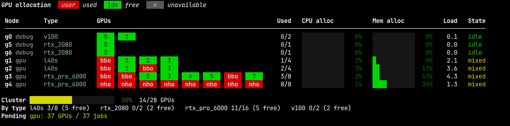

# sui
*/sway/*

**See which GPUs on your Slurm cluster are free, and who is using the rest.**

`sui` shows every GPU node as a row of boxes, one box per GPU. Run it to
find out where a job will fit before you submit it.



## Install

You need Python 3.10+ and a machine where the Slurm commands (`sinfo`,
`squeue`, `scontrol`) work, such as a login node.

```bash
uv tool install git+https://github.com/mhyatt000/sui
```

To upgrade later, run `uv tool upgrade sui`.

## Quick start

```bash
sui
```

That's all you need. It prints the current state of the cluster and exits.

## Reading the display

Each GPU is one box:

| Box | Meaning |
|-----|---------|
| 🟥 `foo` | In use. The label is the first three letters of the owner's username. |
| 🟩 `3`   | Free. The number is the GPU index on that node. |
| ⬜ `✕`   | Unavailable. The node is down, draining, or in maintenance. |

The columns:

- **Node**: the node name, followed by its partition(s) in grey.
- **Type**: the GPU model, such as `l40s` or `rtx_pro_6000`.
- **Used**: allocated GPUs out of the node's total.
- **CPU alloc / Mem alloc**: the share of CPU cores and memory that jobs have
  reserved. These turn yellow at 50% and red at 90%.
- **Load**: the node's CPU load average.
- **State**: the Slurm state (`idle`, `mixed`, `allocated`, `drain`, …).
  When Slurm gives a reason, it appears next to the state.

The summary at the bottom shows:

- **Cluster**: total GPUs in use across all available nodes.
- **By type**: used and free GPUs for each GPU model. Use this to decide
  which `--gres=gpu:<type>:N` to request.
- **Pending**: GPUs and jobs waiting in the queue for each partition. A large
  number here means you should expect to wait.

> **Note:** "Used" means *allocated* by Slurm, not actually busy. A GPU can be
> reserved by a job that is idle. To see real utilization, run `nvidia-smi`
> on the node.

## Options

```bash
sui              # print once and exit
sui -w 5         # live full-screen view, refreshed every 5 seconds (Ctrl-C to quit)
sui -p gpu       # only show nodes in the "gpu" partition
sui --json       # machine-readable output for scripts
```

You can combine these, for example `sui -p debug -w 10`.

| Flag | Description |
|------|-------------|
| `-p`, `--partition NAME` | Only show nodes (and pending jobs) in this partition |
| `-w`, `--watch SEC` | Keep the display open and refresh every `SEC` seconds |
| `--json` | Print JSON instead of the table |
| `-h`, `--help` | Show help |

## Scripting with `--json`

`--json` prints a `nodes` list and a `pending` map. For example, to list
the nodes that have a free GPU:

```bash
sui --json | jq -r '.nodes[] | select(.gpus_used < .gpus_total) | "\(.name)\t\(.gpu_type)\t\(.gpus_total - .gpus_used) free"'
```

Each node includes `name`, `partitions`, `gpu_type`, `gpus_total`,
`gpus_used`, `used_idx`, `owners` (GPU index → user), `users` (user → GPU
count), CPU and memory allocation, `load`, `state`, and `reason`.

## Development

```bash
git clone https://github.com/mhyatt000/sui && cd sui
uv run sui
```
